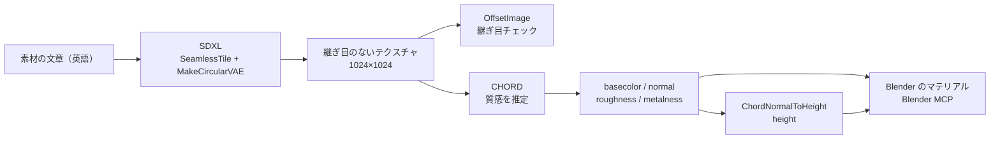

# comfy-texture

Claude Code に「〜のテクスチャを作って」と頼むと、ローカルの ComfyUI で**継ぎ目のない（シームレスな）テクスチャ**と **PBR マップ5枚**（basecolor / normal / roughness / metalness / height）を作り、必要なら **Blender のマテリアル**まで設定するスキルです。

A Claude Code skill that makes a seamless texture and five PBR maps with a local ComfyUI (SDXL + CHORD), and can set them up as a Blender material.


## 流れ




サンプル画像には CHORD の出力が含まれます。CHORD のライセンスは、下の「ライセンス」を見てください。

## 動作を確かめた環境

- Windows 11、GeForce RTX 5070（VRAM 12GB）、メモリ 64GB
- ComfyUI：Comfy Desktop 2 v0.45.3（Python 3.13、PyTorch 2.12.1+cu130）
- Blender 5.3（Blender MCP でつなぐ）
- Claude Code

## 必要なもの

### カスタムノード

| ノードパック | 使うノード | ライセンス |
|---|---|---|
| [ComfyUI-seamless-tiling](https://github.com/spinagon/ComfyUI-seamless-tiling)（spinagon） | SeamlessTile、MakeCircularVAE、OffsetImage | GPL-3.0 |
| [ComfyUI-Chord](https://github.com/ubisoft/ComfyUI-Chord)（Ubisoft） | ChordLoadModel、ChordMaterialEstimation、ChordNormalToHeight | リポジトリを参照 |

### モデル

テクスチャを作るだけなら、表の上の2つ（SDXL と CHORD）で足ります。

| ファイル | 入手元（Hugging Face） | 置き場所（models の下） | 使うワークフロー |
|---|---|---|---|
| sd_xl_base_1.0.safetensors | [stabilityai/stable-diffusion-xl-base-1.0](https://huggingface.co/stabilityai/stable-diffusion-xl-base-1.0) | checkpoints | テクスチャ、SDXL |
| chord_v1.safetensors | [Ubisoft/ubisoft-laforge-chord](https://huggingface.co/Ubisoft/ubisoft-laforge-chord)（ライセンスへの同意が必要） | checkpoints | テクスチャ |
| z_image_turbo_nvfp4.safetensors | [Comfy-Org/Z-Image-Turbo](https://huggingface.co/Comfy-Org/Z-Image-Turbo) の split_files/diffusion_models | diffusion_models | Z-Image |
| qwen_3_4b.safetensors | [Comfy-Org/Z-Image-Turbo](https://huggingface.co/Comfy-Org/Z-Image-Turbo) の split_files/text_encoders | text_encoders | Z-Image、klein |
| ae.safetensors | [Comfy-Org/Z-Image-Turbo](https://huggingface.co/Comfy-Org/Z-Image-Turbo) の split_files/vae | vae | Z-Image |
| flux-2-klein-4b-fp8.safetensors | [black-forest-labs/FLUX.2-klein-4b-fp8](https://huggingface.co/black-forest-labs/FLUX.2-klein-4b-fp8) | diffusion_models | klein |
| flux2-vae.safetensors | [Comfy-Org/Flux-2-Klein-4B](https://huggingface.co/Comfy-Org/Flux-2-Klein-4B) の split_files/vae | vae | klein |

## セットアップ

1. **カスタムノードを入れる**：ComfyUI Manager から入れるか、ComfyUI の `custom_nodes` に `git clone` します。ComfyUI-Chord は `requirements.txt` の依存も入れます。入れたら ComfyUI を再起動します。
   - 依存を入れる前後で、PyTorch の版が変わっていないかを確かめると安全です。`pip install --dry-run` で先に確かめられます。
2. **モデルを置く**：上の表のとおりに置きます。CHORD は Hugging Face のページでライセンスに同意してから、ダウンロードします。
3. **スキルを置く**：`skills/comfy-texture` フォルダを、Claude Code のスキルのフォルダ（`~/.claude/skills/comfy-texture`。Windows は `%USERPROFILE%\.claude\skills\comfy-texture`）にコピーします。
4. **確かめる**：ComfyUI を起動して、ノードとワークフローが読めるかを見ます。

   ```powershell
   # Windows（PowerShell）
   $skill = "$env:USERPROFILE\.claude\skills\comfy-texture"
   python "$skill\scripts\run_comfy.py" --node-info SeamlessTile ChordLoadModel
   python "$skill\scripts\run_comfy.py" "$skill\workflows\tileable_pbr_api.json" --list
   ```

   ```bash
   # macOS / Linux（未確認）
   SKILL=~/.claude/skills/comfy-texture
   python3 "$SKILL/scripts/run_comfy.py" --node-info SeamlessTile ChordLoadModel
   python3 "$SKILL/scripts/run_comfy.py" "$SKILL/workflows/tileable_pbr_api.json" --list
   ```

## 使い方

### Claude Code に頼む

ComfyUI を起動しておき、Claude Code に頼みます。`/comfy-texture 苔むした石畳` のように呼ぶこともできます。

- 「苔むした石畳のシームレスなテクスチャを作って。保存先は ./textures」
- 「錆びた鉄板の PBR マテリアルを作って、Blender で選択中のオブジェクトに貼って」

Blender に貼るときは、Blender を MCP でつなぎ、貼りたい .blend を開いておきます。継ぎ目の確認で失敗したら、Claude Code が seed を変えて3回まで作り直します。

### スクリプトを直接使う

`run_comfy.py` は Python の標準ライブラリだけで動きます。

```bash
python run_comfy.py workflows/tileable_pbr_api.json \
  --prompt "<素材>, top-down orthographic view, flat even diffuse lighting, no shadows, seamless tileable texture, highly detailed surface" \
  --negative "perspective, vanishing point, cast shadow, specular highlight, objects, border, frame, text, watermark, vignette, blurry" \
  --seed random --out textures/<素材名> --prefix <素材名>
```

`<素材名>_texture.png`、`_seam_check.png`、`_basecolor.png`、`_normal.png`、`_roughness.png`、`_metalness.png`、`_height.png` が保存されます。`--list` でノードの ID を調べ、`--set ID.入力名=値` で解像度なども変えられます。

## ワークフロー

| ファイル | 中身 | 時間 |
|---|---|---|
| `tileable_pbr_api.json` | SDXL（30ステップ、dpmpp_2m karras、CFG 7）＋継ぎ目なし → CHORD で PBR マップ5枚 | 14.2秒 |
| `zimage_t2i_api.json` | Z-Image Turbo NVFP4（8ステップ、res_multistep、CFG 1、shift 3） | 3.9秒 |
| `klein_t2i_api.json` | FLUX.2 [klein] 4B FP8（蒸留版。4ステップ、euler、CFG 1） | 2.1秒 |
| `sdxl_t2i_api.json` | SDXL base（25ステップ、dpmpp_2m karras、CFG 7） | 8.1秒 |

時間は RTX 5070 で 1024×1024 を1枚、2回目に実行したときのものです。初回のテクスチャは、CHORD の読み込みを含めて 49.3秒でした。Z-Image、klein、SDXL のワークフローは、ComfyUI の公式テンプレート（[Comfy-Org/workflow_templates](https://github.com/Comfy-Org/workflow_templates)、MIT）をもとにしています。Z-Image と klein にはネガティブのノードがないので、`--negative` は使えません。

## ハマりどころ

1. **SeamlessTile と MakeCircularVAE は「Modify in place」にする。** 「Make a copy」では、ComfyUI 0.45.3 でモデルの複製がエラーになり、VAE の複製のあとにサーバーが異常終了しました（ヒープ破損。原因は推定で、確定ではありません）。
2. **テクスチャのあとに普通の SDXL を使うと、タイル状の画像になる。** 「Modify in place」が、読み込み済みの SDXL を書き換えるためです。`POST http://127.0.0.1:8188/free` に `{"unload_models": true, "free_memory": true}` を送るか、ComfyUI を再起動すると元に戻ります。
3. **CHORD の normal は DirectX 形式**（緑＝Y が下向き）です。Blender 5.3 なら、Normal Map ノードの convention を DirectX にします。古い Blender では G チャンネルを反転します。
4. **claude.ai の「ComfyUI」コネクタは Comfy Cloud 用**で、手元の ComfyUI には届きません。このスキルは、手元の ComfyUI の HTTP API（127.0.0.1:8188）に直接つなぎます。

## ライセンス

- このリポジトリのスクリプト、ワークフロー、文書は MIT です（[LICENSE](LICENSE)）。公式テンプレートをもとにした部分は [THIRD_PARTY_NOTICES.md](THIRD_PARTY_NOTICES.md) を見てください。
- モデルとカスタムノードは入っていません。それぞれのライセンスに従ってください。特に **CHORD は研究用途限定**（Ubisoft Machine Learning License (Research-Only - Copyleft)）で、商用利用は禁止されています。作ったテクスチャを使った作品を公開・販売するときは、条件を確かめてください。
- `docs/images/` のサンプル画像には、CHORD の出力が含まれます。

## 作業の記録

この環境は、手順書とルールを渡して Claude Code に作ってもらいました。進め方、テストの結果、起きた問題と対処は [docs/notes.md](docs/notes.md) にあります。
