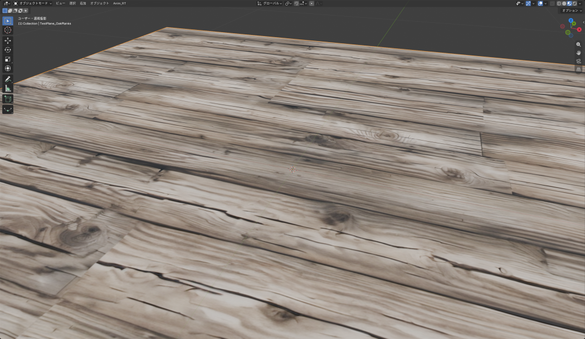
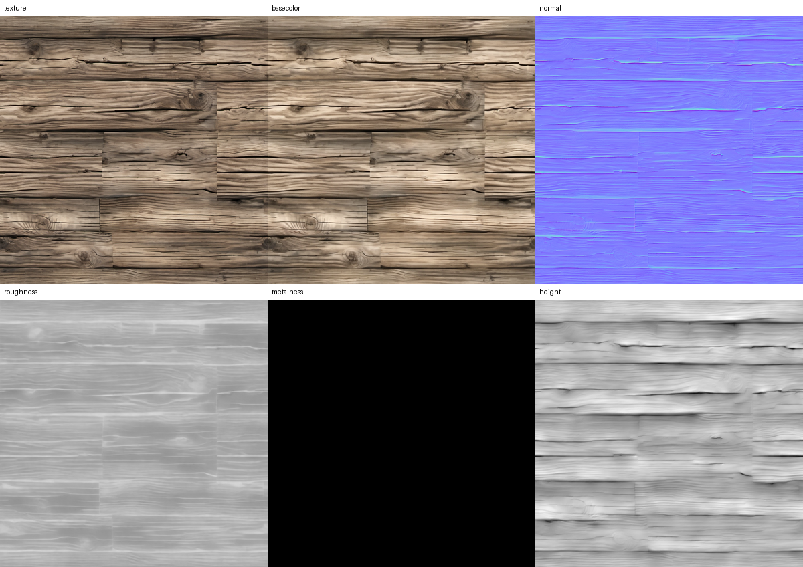
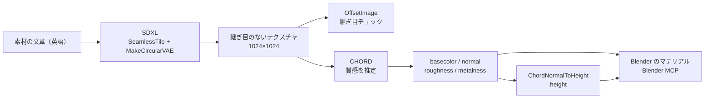
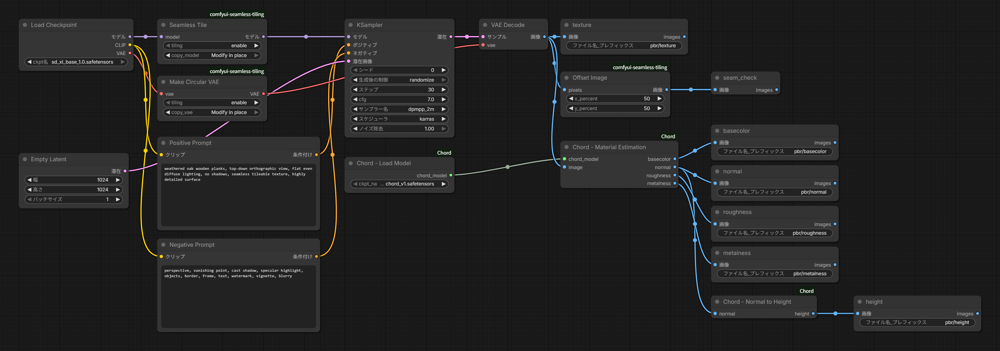
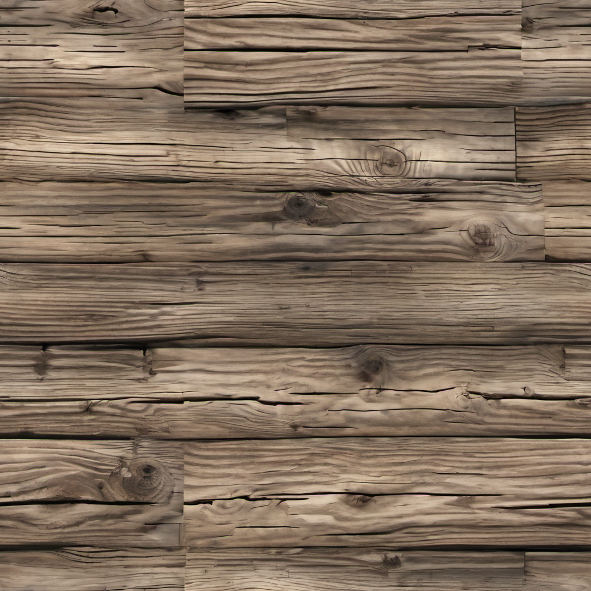
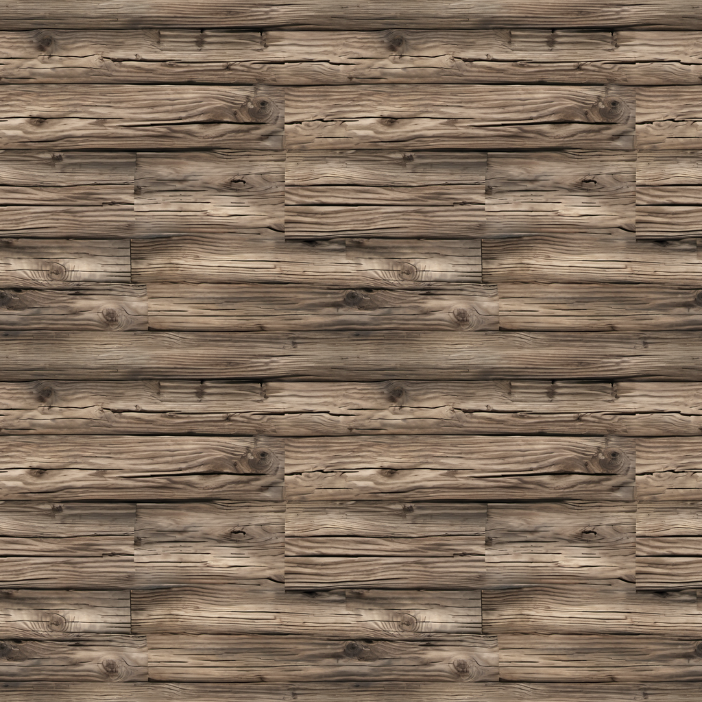

# comfy-texture

Claude Code に「〜のテクスチャを作って」と頼むと、ローカルの ComfyUI で**継ぎ目のない（シームレスな）テクスチャ**と **PBR マップ5枚**（basecolor / normal / roughness / metalness / height）を作り、必要なら **Blender のマテリアル**まで設定するスキルです。

A Claude Code skill that makes a seamless texture and five PBR maps with a local ComfyUI (SDXL + CHORD), and can set them up as a Blender material. The docs are in Japanese.



## できること

素材を言葉で頼むと、次の7枚の画像ができます。RTX 5070 では、2回目以降は1回あたり約14秒です。

| 出力 | 中身 |
|---|---|
| `<素材名>_texture.png` | 継ぎ目のない元の画像（1024×1024） |
| `<素材名>_seam_check.png` | 継ぎ目の確認用。左右・上下に半分ずらした画像 |
| `<素材名>_basecolor.png` | 色。影や光を含まない、素材そのものの色 |
| `<素材名>_normal.png` | 凹凸の向き（DirectX 形式） |
| `<素材名>_roughness.png` | ざらつき。白いほどざらざらで、つやがない |
| `<素材名>_metalness.png` | 金属っぽさ。金属でなければ黒（0） |
| `<素材名>_height.png` | 高さ。凹凸を強めるのに使う |

- 頼めば、Blender で選んでいるオブジェクトに、マテリアルとして設定します（Blender MCP）。
- 継ぎ目の確認で失敗したら、Claude Code が seed を変えて3回まで作り直します。
- 普通の画像生成用に、Z-Image Turbo、FLUX.2 [klein] 4B、SDXL のワークフローも入っています。



## 仕組み



1. **継ぎ目のない画像を作る（SDXL）**：SeamlessTile と MakeCircularVAE が、SDXL のモデルと VAE の畳み込みの計算を書き換えます。画像の端を反対側の端とつながっているものとして計算する（circular padding）ので、左右・上下の端がつながる絵になります。
2. **継ぎ目を確かめる（OffsetImage）**：画像を左右・上下に半分ずらすと、元の端が中央に集まります。継ぎ目があれば、中央に十字の線が見えます。
3. **質感の画像を推定する（CHORD）**：Ubisoft の CHORD が、1枚の画像から basecolor・normal・roughness・metalness を推定します。height は、ChordNormalToHeight が normal から計算します。
4. **Blender のマテリアルにする**：Claude Code が Blender MCP で、5枚の画像を Principled BSDF につなぎます。

## 動作を確かめた環境

| 項目 | 値 |
|---|---|
| OS | Windows 11 |
| GPU | GeForce RTX 5070（VRAM 12GB） |
| メモリ | 64GB |
| ComfyUI | Comfy Desktop 2 v0.45.3（フロントエンド 1.58.5） |
| Python / PyTorch | 3.13 / 2.12.1+cu130 |
| Blender | 5.3（Blender MCP でつなぐ） |

macOS と Linux では確かめていません。

## 必要なもの

### カスタムノード

| ノードパック | 使うノード | ライセンス |
|---|---|---|
| [ComfyUI-seamless-tiling](https://github.com/spinagon/ComfyUI-seamless-tiling)（spinagon） | SeamlessTile、MakeCircularVAE、OffsetImage | GPL-3.0 |
| [ComfyUI-Chord](https://github.com/ubisoft/ComfyUI-Chord)（Ubisoft） | ChordLoadModel、ChordMaterialEstimation、ChordNormalToHeight | Ubisoft Machine Learning License (Research-Only - Copyleft) |

### モデル

テクスチャを作るだけなら、表の上の2つ（SDXL と CHORD、合わせて約9.7GB）で足ります。7つ全部で約27GB です。

| ファイル | サイズ | 入手元（Hugging Face） | 置き場所（models の下） | 使うワークフロー |
|---|---|---|---|---|
| sd_xl_base_1.0.safetensors | 6.9GB | [stabilityai/stable-diffusion-xl-base-1.0](https://huggingface.co/stabilityai/stable-diffusion-xl-base-1.0) | checkpoints | テクスチャ、SDXL |
| chord_v1.safetensors | 2.8GB | [Ubisoft/ubisoft-laforge-chord](https://huggingface.co/Ubisoft/ubisoft-laforge-chord)（ライセンスへの同意が必要） | checkpoints | テクスチャ |
| z_image_turbo_nvfp4.safetensors | 4.5GB | [Comfy-Org/Z-Image-Turbo](https://huggingface.co/Comfy-Org/Z-Image-Turbo) の split_files/diffusion_models | diffusion_models | Z-Image |
| qwen_3_4b.safetensors | 8.0GB | [Comfy-Org/Z-Image-Turbo](https://huggingface.co/Comfy-Org/Z-Image-Turbo) の split_files/text_encoders | text_encoders | Z-Image、klein |
| ae.safetensors | 0.3GB | [Comfy-Org/Z-Image-Turbo](https://huggingface.co/Comfy-Org/Z-Image-Turbo) の split_files/vae | vae | Z-Image |
| flux-2-klein-4b-fp8.safetensors | 4.1GB | [black-forest-labs/FLUX.2-klein-4b-fp8](https://huggingface.co/black-forest-labs/FLUX.2-klein-4b-fp8) | diffusion_models | klein |
| flux2-vae.safetensors | 0.3GB | [Comfy-Org/Flux-2-Klein-4B](https://huggingface.co/Comfy-Org/Flux-2-Klein-4B) の split_files/vae | vae | klein |

<details>
<summary>直接ダウンロードできる URL（CHORD 以外）</summary>

- https://huggingface.co/stabilityai/stable-diffusion-xl-base-1.0/resolve/main/sd_xl_base_1.0.safetensors
- https://huggingface.co/Comfy-Org/Z-Image-Turbo/resolve/main/split_files/diffusion_models/z_image_turbo_nvfp4.safetensors
- https://huggingface.co/Comfy-Org/Z-Image-Turbo/resolve/main/split_files/text_encoders/qwen_3_4b.safetensors
- https://huggingface.co/Comfy-Org/Z-Image-Turbo/resolve/main/split_files/vae/ae.safetensors
- https://huggingface.co/black-forest-labs/FLUX.2-klein-4b-fp8/resolve/main/flux-2-klein-4b-fp8.safetensors
- https://huggingface.co/Comfy-Org/Flux-2-Klein-4B/resolve/main/split_files/vae/flux2-vae.safetensors

CHORD は Hugging Face にログインし、モデルのページでライセンスに同意してからダウンロードします。

</details>

## セットアップ

### 1. カスタムノードを入れる

ComfyUI Manager から入れるか、ComfyUI の `custom_nodes` に `git clone` します。

```bash
cd <ComfyUI>/custom_nodes
git clone https://github.com/spinagon/ComfyUI-seamless-tiling
git clone https://github.com/ubisoft/ComfyUI-Chord
```

ComfyUI-Chord の依存（diffusers、imageio、omegaconf）は、**ComfyUI が使っている Python** で入れます。先に `--dry-run` で、torch などが入れ替わらないことを確かめると安全です。

```powershell
# 例：Comfy Desktop（Windows）。<ComfyUI> は ComfyUI 本体のフォルダ
$py = "<ComfyUI>\.venv\Scripts\python.exe"
& $py -m pip install --dry-run -r "<ComfyUI>\custom_nodes\ComfyUI-Chord\requirements.txt"
& $py -m pip install -r "<ComfyUI>\custom_nodes\ComfyUI-Chord\requirements.txt"
& $py -c "import torch; print(torch.__version__)"
```

入れたら ComfyUI を再起動し、起動時のログに `IMPORT FAILED` が出ていないかを見ます。

### 2. モデルを置く

上の表のとおりに、ComfyUI の `models` の下に置きます。CHORD は、置いたあと再起動しなくても ComfyUI の選択肢に出ました。

### 3. スキルを置く

`skills/comfy-texture` フォルダを、Claude Code のスキルのフォルダにコピーします。

```powershell
# Windows（PowerShell）。このリポジトリのフォルダで実行
Copy-Item -Recurse .\skills\comfy-texture "$env:USERPROFILE\.claude\skills\comfy-texture"
```

```bash
# macOS / Linux（未確認）
cp -r skills/comfy-texture ~/.claude/skills/comfy-texture
```

### 4. 確かめる

ComfyUI を起動して、ノードとモデルとワークフローが読めるかを見ます。

```powershell
# Windows（PowerShell）
$skill = "$env:USERPROFILE\.claude\skills\comfy-texture"
python "$skill\scripts\run_comfy.py" --node-info SeamlessTile ChordLoadModel
python "$skill\scripts\run_comfy.py" --models checkpoints
python "$skill\scripts\run_comfy.py" "$skill\workflows\tileable_pbr_api.json" --list
```

```bash
# macOS / Linux（未確認）
SKILL=~/.claude/skills/comfy-texture
python3 "$SKILL/scripts/run_comfy.py" --node-info SeamlessTile ChordLoadModel
python3 "$SKILL/scripts/run_comfy.py" --models checkpoints
python3 "$SKILL/scripts/run_comfy.py" "$SKILL/workflows/tileable_pbr_api.json" --list
```

`--node-info` でノードが「見つかりません」と出たら、カスタムノードが読み込まれていません。`--models checkpoints` に `sd_xl_base_1.0.safetensors` と `chord_v1.safetensors` があれば、モデルは置けています。

## 使い方

### Claude Code に頼む

ComfyUI を起動しておき、Claude Code に頼みます。`/comfy-texture 苔むした石畳` のように呼ぶこともできます。

- 「苔むした石畳のシームレスなテクスチャを作って。保存先は ./textures」
- 「錆びた鉄板の PBR マテリアルを作って、Blender で選択中のオブジェクトに貼って」

保存先を言わなければ、プロジェクトのフォルダの `textures/<素材名>` に保存されます。頼んだあと、Claude Code は SKILL.md の手順どおりに進めます。

1. ワークフローがあるかと、ComfyUI につながるかを確かめる
2. 素材の説明を、英語のプロンプトにする（[プロンプトの書き方](#プロンプトの書き方)）
3. run_comfy.py でワークフローを実行し、7枚の画像を保存する
4. できた画像を開いて見る。確認用の画像の中央に十字の線があれば、seed を変えて作り直す（3回まで。それでもだめならプロンプトを直し、最後は相談してくる）
5. 頼まれていれば、Blender のバージョンと API を確かめてから、マテリアルを組んで画面で確かめる
6. 保存した場所、使ったプロンプトと seed を報告する。seed を控えておけば、同じものを作り直せる

### Blender に貼る

1. Blender を起動し、Blender MCP でつなぐ
2. 貼りたい .blend を開き、オブジェクトを選んでおく
3. 「〜を作って、選択中のオブジェクトに貼って」と頼む

Claude Code は、Blender で今開いているファイルに対して作業します。組み方は [Blender のマテリアル](#blender-のマテリアル) を見てください。

### スクリプトを直接使う

`run_comfy.py` は Python の標準ライブラリだけで動きます。Claude Code を使わずに、これだけで動かすこともできます。

```bash
python run_comfy.py workflows/tileable_pbr_api.json \
  --prompt "<素材>, top-down orthographic view, flat even diffuse lighting, no shadows, seamless tileable texture, highly detailed surface" \
  --negative "perspective, vanishing point, cast shadow, specular highlight, objects, border, frame, text, watermark, vignette, blurry" \
  --seed random --out textures/<素材名> --prefix <素材名>
```

| オプション | 中身 |
|---|---|
| `--list` | ノードの一覧と、変えられる値を表示する |
| `--prompt` / `--negative` | タイトルが `Positive Prompt` / `Negative Prompt` のノードに入れる |
| `--seed random` または数字 | seed を変える。数字を入れれば同じ画像を作り直せる |
| `--set ID.入力名=値` | 好きな値を変える（何回でも）。例：`--set 6.width=2048 --set 6.height=2048` |
| `--out` / `--prefix` | 保存先のフォルダ / ファイル名の先頭 |
| `--node-info ノード名…` | ノードの入力名・型・選択肢を ComfyUI から取る |
| `--models フォルダ名` | ComfyUI に入っているモデルの一覧（例：`checkpoints`） |
| `--server host:port` | 接続先。省略すると 127.0.0.1 の 8188、8000 の順に探す |
| `--timeout 秒` | 終わるのを待つ上限（既定 900） |

結果は JSON で出ます。`ok`、`prompt_id`、かかった秒数（`seconds`）、変えた値（`changes`）、保存したファイル（`files`）が入っています。

## ワークフロー



`.json` のファイルを ComfyUI の画面にドラッグ＆ドロップすると、ワークフローとして開けます（ComfyUI 0.45.3、フロントエンド 1.58.5 で確認）。

| ファイル | 中身 | 初回 | 2回目 |
|---|---|---|---|
| `tileable_pbr_api.json` | SDXL＋継ぎ目なし → CHORD で PBR マップ5枚 | 49.3秒 | 14.2秒 |
| `zimage_t2i_api.json` | Z-Image Turbo NVFP4 の普通の画像生成 | 8.8秒 | 3.9秒 |
| `klein_t2i_api.json` | FLUX.2 [klein] 4B FP8 の普通の画像生成 | 5.1秒 | 2.1秒 |
| `sdxl_t2i_api.json` | SDXL base の普通の画像生成 | 11.3秒 | 8.1秒 |

時間は RTX 5070 で 1024×1024 を1枚作ったときのものです。初回はモデルを解放した直後で、テクスチャの初回には CHORD の読み込みが含まれます。2回目は seed を変えてもう一度実行したときです。

### tileable_pbr_api.json のノード

| ID | ノード | 役割・設定 |
|---|---|---|
| 1 | CheckpointLoaderSimple | SDXL を読み込む |
| 2 | SeamlessTile | モデル側の継ぎ目をなくす（tiling: enable、copy_model: Modify in place） |
| 3 | MakeCircularVAE | VAE 側の継ぎ目をなくす（tiling: enable、copy_vae: Modify in place） |
| 4 | CLIPTextEncode「Positive Prompt」 | 素材の説明 |
| 5 | CLIPTextEncode「Negative Prompt」 | 避けたいもの |
| 6 | EmptyLatentImage | 大きさ 1024×1024 |
| 7 | KSampler | 30ステップ、dpmpp_2m、karras、CFG 7 |
| 8 | VAEDecode | 画像に戻す |
| 9 | SaveImage「texture」 | 元の画像を保存 |
| 10 | OffsetImage | 左右・上下に 50% ずらす |
| 11 | PreviewImage「seam_check」 | 確認用に表示 |
| 12 | ChordLoadModel | `chord_v1.safetensors` を読み込む |
| 13 | ChordMaterialEstimation | basecolor / normal / roughness / metalness を推定 |
| 14 | ChordNormalToHeight | normal から height を計算 |
| 15〜19 | SaveImage | basecolor / normal / roughness / metalness / height を保存 |

run_comfy.py はノードのタイトルで、プロンプトの入れ先と保存するファイルの名前を決めます。タイトルは変えないでください。

### 普通の画像生成のワークフロー

ComfyUI の公式テンプレートを、普通のノードに展開したものです。

- **Z-Image Turbo**：UNETLoader（NVFP4）、CLIPLoader（qwen_3_4b、type lumina2）、ModelSamplingAuraFlow（shift 3）、KSampler（res_multistep、8ステップ、CFG 1、simple）。ネガティブは ConditioningZeroOut
- **FLUX.2 [klein] 4B**：FP8 版は蒸留モデルで、モデルカードどおり 4ステップ・CFG 1 にしています。CFGGuider、KSamplerSelect（euler）、Flux2Scheduler、SamplerCustomAdvanced の構成です。幅と高さは PrimitiveInt のノード（ID 8 と 9）でまとめて変えられます
- **SDXL**：公式テンプレートと同じ設定（dpmpp_2m karras、25ステップ、CFG 7）

Z-Image と klein にはネガティブのノードがないので、`--negative` は使えません。

## プロンプトの書き方

- 型：`<素材の説明>, top-down orthographic view, flat even diffuse lighting, no shadows, seamless tileable texture, highly detailed surface`
- ネガティブ：`perspective, vanishing point, cast shadow, specular highlight, objects, border, frame, text, watermark, vignette, blurry`
- 例：`weathered dark oak wooden planks with nail holes and grain`

型の後半は、真上から見た絵にし（top-down orthographic view）、影や強い光が入らないようにする（flat even diffuse lighting, no shadows）ための決まり文句です。素材の説明には、古さ・汚れ・湿り気・色味など、どんな状態かを具体的に書くと狙いに近づきます。

## Blender のマテリアル

| 画像 | 色空間 | つなぎ先 |
|---|---|---|
| basecolor | sRGB | Principled BSDF の Base Color |
| roughness | Non-Color | Roughness |
| metalness | Non-Color | Metallic |
| normal | Non-Color | Normal Map（Tangent、**convention = DirectX**）→ Bump の Normal |
| height | Non-Color | Bump の Height（Strength 1、Distance 5mm）→ Principled BSDF の Normal |

- Texture Coordinate の UV → Mapping → 5枚の画像。画像の端は Repeat にして繰り返します。
- 色の画像以外は Non-Color にします。sRGB のままだと、数値が色として補正されてしまいます。
- 大きさは実物に合わせます。サンプルでは画像1枚に板が6〜7枚写っていたので、板1枚の幅が約20cm になるように、画像1枚を約1.3m（2.6m の平面に 2×2）にしました。
- CHORD の normal は DirectX 形式です。Blender 5.3 は Normal Map ノードの convention で切り替えられます。この設定がない古い Blender や、OpenGL 形式のソフト（Unity、glTF など）では、G チャンネルを反転します。Unreal Engine は DirectX 形式なので、そのまま使えます。

## 継ぎ目の確かめ方

 

左：半分ずらした確認用の画像。中央に十字の境目はありません。右：テクスチャを 2×2 に並べた画像。

目で見るほかに、数値でも確かめました。左端の列と右端の列の差（上下なら上端の行と下端の行の差）を、画像の中の隣り合う列どうしの差の中央値で割ります。継ぎ目がなければ、端どうしの差も中の隣どうしと同じくらいになるので、1 に近くなります。

| 画像 | 左右 | 上下 |
|---|---|---|
| texture | 0.99 | 1.74 |
| normal | 1.07 | 1.01 |
| 普通の写真（参考） | 43.7 | 22.3 |

## ハマりどころ

1. **SeamlessTile と MakeCircularVAE は「Modify in place」にする。**
   - 「Make a copy」では、ComfyUI 0.45.3 でモデルの複製がエラー（`'NoneType' object is not callable`）になりました。VAE の複製のあとには、サーバーが異常終了しました。Windows のイベントログでは、例外コード 0xc0000374（ヒープ破損）でした。
   - 原因は推定で、確定ではありません。両方を「Modify in place」にしてからは、連続生成4回と PBR 生成2回で落ちていません。
2. **テクスチャのあとに普通の SDXL を使うと、タイル状の画像になる。**
   - 「Modify in place」は、読み込み済みの SDXL を書き換えます。書き換えたモデルがキャッシュに残るためです。
   - `POST http://127.0.0.1:8188/free` に `{"unload_models": true, "free_memory": true}` を送ると、基準とまったく同じ画像に戻りました。ComfyUI を再起動しても戻ります。`unload_models` だけを送る方法は確かめていません。
3. **CHORD の normal は DirectX 形式**（緑＝Y が下向き）です。
   - 根拠は2つです。CHORD の `normal_to_height.py` が DirectX を前提にした式になっていること。normal の緑の値と元の画像の明るさの上下方向の変化に、DirectX 形式で読んだときに合う正の相関（2つのテクスチャで +0.55 と +0.41）があったことです。
   - Blender での設定は [Blender のマテリアル](#blender-のマテリアル) を見てください。
4. **claude.ai の「ComfyUI」コネクタは Comfy Cloud 用**です。手元の ComfyUI のモデルやノードは見えず、使うとクラウドのクレジットを使います。このスキルは、手元の ComfyUI の HTTP API（127.0.0.1:8188）に直接つなぎます。

## 困ったとき

| 症状 | 見ること・やること |
|---|---|
| 「ComfyUI に接続できません」 | ComfyUI が起動しているか。ポートが 8188 / 8000 以外なら `--server 127.0.0.1:<ポート>` |
| 「ノードの設定エラー」（node_errors） | エラーに出たノード ID を `--list` で見る。多いのはモデルのファイル名の違いなので、`--models checkpoints` と比べる |
| 実行中のエラー（out of memory など） | `--set` で解像度を下げるか、ComfyUI を再起動する。画像の生成と Blender のレンダリングを同時に動かさない |
| 「UI 形式のワークフローです」 | ComfyUI の「Export Workflow (API)」で書き出した JSON を使う |
| いつまでも終わらない | ComfyUI が落ちていないか。落ちていても、run_comfy.py は `--timeout`（既定 900秒）まで待ち続ける |
| 普通の SDXL がタイル状になる | 上の「ハマりどころ」の2。`/free` を送る |
| ComfyUI を更新したあと | PyTorch の版が変わっていないかと、カスタムノードが読めるかを確かめる（下のコマンド） |

```powershell
& "<ComfyUI>\.venv\Scripts\python.exe" -c "import torch; print(torch.__version__)"
python "$env:USERPROFILE\.claude\skills\comfy-texture\scripts\run_comfy.py" --node-info SeamlessTile ChordLoadModel
```

## ライセンス

- このリポジトリのスクリプト、ワークフロー、文書は MIT です（[LICENSE](LICENSE)）。公式テンプレートをもとにした部分は [THIRD_PARTY_NOTICES.md](THIRD_PARTY_NOTICES.md) を見てください。
- モデルとカスタムノードは入っていません。それぞれのライセンスに従ってください。特に **CHORD は研究用途限定**（Ubisoft Machine Learning License (Research-Only - Copyleft)）で、商用利用は禁止されています。作ったテクスチャを使った作品を公開・販売するときは、条件を確かめてください。
- `docs/images/` のサンプル画像には、CHORD の出力が含まれます。

## 作業の記録

この環境は、手順書とルールを渡して Claude Code に作ってもらいました。進め方、テストの結果、起きた問題と対処は [docs/notes.md](docs/notes.md) にあります。
